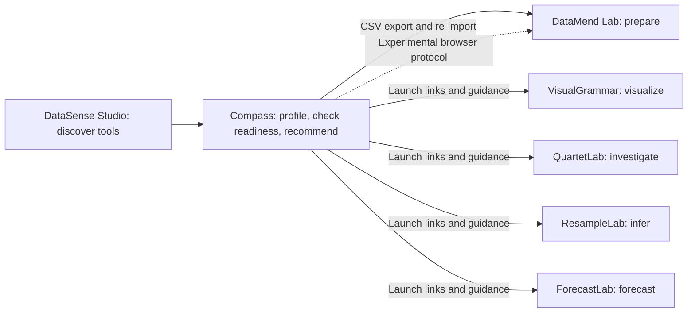

# DataSense Studio product and ecosystem audit

Audit date: October 28, 2026 (America/New_York). The original audit below records the implementation and verification at that time. Subsequent companion-lab work is documented in ECOSYSTEM_UPGRADE.md.

## Commit readiness review — October 29, 2026

The Studio changes were reviewed again for the user-authorized local commit. `npm run build`, `npm test`, and `npm run test:browser` all passed. The Chromium run verified responsive routes and details, six samples, invalid and oversized inputs, inert adversarial column names, stale-read protection, 5,000-row import/export, cleaning restoration, and direct Compass entry, with no uncaught browser errors. The package description's encoding was corrected, and local portfolio/companion-lab artifacts are excluded from Git.

The implementation is suitable for a local checkpoint. This action does not push or deploy Studio, and the release limitations below remain applicable. The pre-existing LICENSE whitespace edit is excluded from this commit.

## Outcome and scope

DataSense Studio retains its static architecture and distinctive paper/emerald/dark-instrument design. The work prioritizes a clear first-use path, a usable analytical workspace on phones, reliable imports, and data integrity. It fixes actual runtime and security defects alongside the visual changes.

All six repositories were available locally. Their checked-out main commits matched the latest commits returned by GitHub during this audit. The latest workflow in each repository reported success, and the open issue/PR collection returned no entries. These are observations at audit time, not guarantees for future revisions. Branch protection was not changed or assessed.

Existing edits to Studio's LICENSE and DataMend's datamend-compass-adapter.js were preserved. Only Studio was modified. Companion applications received source/architecture/CI inspection and automated verification, not a complete browser UX audit.

## Product direction and journeys

The differentiators are local processing, transparent statistical diagnostics, mixed-variable relationship exploration, and five purpose-specific labs. These are more useful product signals than additional decorative assets.

Visual direction: warm paper (#F6F4EE), legible ink (#141619), restrained emerald (#0F6E56), and dark analytical surfaces (#0D1014). Editorial serif headings distinguish the product; sans-serif body copy supports reading; monospaced numerical readouts support comparison. System font fallbacks remain usable without external font requests. A separate product stylesheet uses the existing tokens and is bundled into the existing CSS asset.

The three audience perspectives are design hypotheses, not claims of user research:

- First-time visitor: a concise value statement, one primary “Start with Compass” action, sample data with no account requirement, and a secondary lab directory. Interactive lessons follow the core analytical workflows.
- Professional analyst: readiness cautions, variable selection, readable summary metrics, horizontally scrollable dense tables/charts, explicit import errors, data export, and preservation of existing work after failure.
- Returning power user: direct /compass/ entry, global search, saved instruments, sample switching, source links, and dark appearance remain available. Search and saved controls remain reachable through the mobile menu.

Before screenshots exposed a compressed desktop brand/navigation bar, a large blank instrument area, illegible workspace headings, and severe mobile overflow. After screenshots show an intact header, a prominent primary action, a content-sized instrument, a dark workspace header, and constrained mobile panels. The numeric summary was reorganized so its content fits rather than merely being clipped.

## Ecosystem architecture and ownership

All projects are static browser applications using JavaScript, HTML, and CSS, with no declared npm runtime dependencies. The five labs use ES modules; Studio uses a Python static builder and a standalone JavaScript engine. Node tests exercise domain logic, Python verifies static artifacts, and GitHub Pages hosts the output. No server authentication, database service, or credential-backed API is needed for the inspected workflows.

| Repository / inspected commit | Ownership and implementation | Integration and remaining work |
| --- | --- | --- |
| Studio / 132b9d6 | Product registry, task routing, Compass profiling/readiness, UI, build; src/config/products/registry.json is the canonical destination list | Implemented design, import, security and integrity fixes here. Compass remains a discovery/diagnostic tool, not a replacement for the labs. |
| DataMend / 54325af | js/data-model.js, parsers.js, diagnosis.js, transforms.js, restructure.js, validation.js; data preparation and transformation history | CSV exchange is the supported bridge. The adapter reads root.APP_STATE, while js/app.js exports module-scoped APP_STATE. Incoming envelopes do not feed the actual importer. Row-array export also conflicts with Compass's record-object contract. Needs a deliberate module API and cross-app browser tests. Existing adapter edits were not touched. |
| VisualGrammar / 65867e1 | chart-registry.js, data-engine.js, integrity-engine.js, recommendation-engine.js, renderer.js; graphical specification and literacy | Keep chart recommendation/rendering canonical here. Studio launches and explains the tool. Future portable chart recipes should have a versioned schema, not copied renderer code. |
| QuartetLab / d3215d4 | math-engine.js, renderer.js, exporters.js; bivariate construction, OLS and diagnostic exploration | Keep numerical solver and diagnostics here. A documented x/y column mapping would improve dataset transfer; no automatic dataset import is claimed. |
| ResampleLab / 22feedd | stats-core.js, inference-engine.js, distributions.js, prng.js, worker.js; resampling and inference | Keep simulation and randomness control here. Future transfer should include outcome/group roles and seed, validated with fixed fixtures. |
| ForecastLab / cc21ce8 | math-engine.js, worker.js, renderer.js, exporters.js; time-series models and evaluation | Keep model fitting/backtesting here. A date/outcome/frequency contract could improve transfer without release coupling. |

There are overlapping parsers, summaries, and demonstration calculations. A shared package is not introduced: these applications have different semantic contracts and independent static releases. First establish common interchange fixtures and adapter tests; extract shared code only where equivalence and maintenance benefit are demonstrated.

## Prioritized findings and implemented changes

| Priority | Observed evidence and impact | Resolution / verification | Remaining risk |
| --- | --- | --- | --- |
| P1 | Uploaded column names passed through HTML escaping into quoted inline JavaScript in app.js. Apostrophes could break selection or run injected statements. | Serialize the JS string before HTML attribute escaping. Chromium selects an injection-shaped column and changes its type without executing it. | This is a targeted fix, not a full security certification. A future delegated-event architecture would eliminate the inline-handler context entirely. |
| P1 | executeDataMendCleaning deduplicated by the first identifier, deleting distinct visits with the same ID. Rename-to-existing-column could overwrite data. | Deduplicate exact original records only; reject colliding renames. Targeted unit regressions and browser preview/restore pass. | Cleaning remains a local preview with explicit choices; DataMend is the canonical preparation tool. |
| P1 | Compass referenced undefined --bg-instrument and related tokens. White headings rendered on pale backgrounds. | Defined semantic aliases to the existing palette. Visually checked in light/dark themes. | Full automated contrast audit remains outstanding. |
| P1 | 390px Compass document measured 717px wide. Grid intrinsic sizing, summary cells, and directory minima exceeded phone widths. | Constrained grid children, reflowed metrics and controls, preserved scrolling for dense data. All tested routes/details fit at 390/768/1024/1440px in both themes. | Browser coverage is Chromium, not physical-device certification. |
| P1 | File/paste inputs replaced state and announced success even for unusable data; read failures had no feedback. | Validated imports, persistent status, byte/row/column/cell limits, read-error recovery, stale-reader generation guard, and transactional replacement. Tests cover malformed/empty/header-only JSON/CSV and unsupported/unreadable/oversized files. | Analysis is synchronous within limits; no worker or cancellation of an already-running computation. |
| P1 | CSV duplicate-header suffixes could collide with existing names; JSON nested values and malformed rows silently coerced or discarded data. | Collision-safe names, prototype-safe row dictionaries, JSON schema checks. Regression tests preserve values and leading zeros. | Ragged CSV rows remain parser-reported cautions; users must review readiness before analysis. |
| P1 | Browser DataMend handoff was presented as a launchable feature without workspace integration. | Marked automatic handoff unavailable and retained the file-export/re-import path. Corrected README's integration claim. | Adapter persistence, return URL validation, escaping, and module-state wiring need companion-repo work. |
| P2 | Dense competing CTAs and experiments obscured the main journey; desktop header compressed/wrapped. | Simplified hero and header, moved lessons after core workflows, preserved direct tools/search/saved access. Before/after captures supplied. | No usability study or conversion measurement was conducted. |
| P2 | Search shortcut intercepted slash in a textarea; Escape missed Compass dialogs; focus could leave dialogs. | Text-entry-aware shortcuts, Escape handling, paste focus restoration, dialog Tab containment, pressed states for grouped selectors, keyboard-accessible matrix cells. | Full screen-reader audit, zoom/reflow audit, and every dialog's focus restoration still need dedicated review. |
| P2 | Default “browser” tests used a VM DOM harness; CI had no PR browser checks. | Added real Playwright Chromium journeys and a read-only PR validation workflow with pinned development dependencies. | New GitHub workflow has not run remotely because changes were not pushed. |
| P3 | Brand config canonicalHubUrl targeted the portfolio root; README claimed zero bytes ever leave the machine. | Corrected the canonical project URL and distinguished local dataset computation from static asset requests. | Historical documentation may still contain broader claims. |

## Verification evidence

Runtime used locally: Node 25.9.0, Python 3.13, Playwright 1.64.0, Pillow 12.3.0. CI configuration uses Node 20 and Python 3.11; the new workflow has not yet executed on those versions.

The measured production assets are approximately 285 KiB of application JavaScript, 129 KiB of Compass engine JavaScript, and 77 KiB of CSS, before compression. These are file sizes, not page-load or interaction-speed measurements. Unsupported “60fps” and static “Live Verified” UI claims were removed; no benchmark score is claimed.

| Repository | Command / check | Status | Evidence |
| --- | --- | --- | --- |
| Studio | npm run build | PASS | Generated both entry points, 404, metadata, and synchronized root/dist assets. |
| Studio | npm test | PASS | 13 original statistical scenario groups, new import/cleaning regressions, 8 registry/build tests, and VM DOM suite. |
| Studio | npm run test:browser | PASS | Real Chromium: 8 routes + 5 details × 4 widths × 2 themes; 6 datasets × 4 modes; imports, errors, keyboard, exports, search, preview/restore, direct entry. Zero uncaught browser errors or failed requests in this suite. |
| Studio | python scripts/screenshots/audit_ui.py --label before/after | PASS | Saved full-page desktop/mobile screenshots and measured widths. Baseline phone Compass 717px; revised 390px. |
| DataMend | node --test --test-isolation=none tests/*.test.js; npm run verify | PASS | 12 tests; static verifier checked 34 artifacts. |
| ForecastLab | same Node command; npm run verify; npm run lint:prose | PASS | 18 tests; 31 required files; prose check passed. |
| QuartetLab | same Node command; npm run verify; npm run lint:docs | PASS | 12 tests; 29 files; prose checks passed. |
| ResampleLab | same Node command; npm run verify | PASS | 11 tests; 35 static files. |
| VisualGrammar | same Node command; npm run verify | PASS | 25 tests; static verifier and 11-document prose audit passed. |
| All five companion labs | Initial npm test under restricted process sandbox | BLOCKED, recovered | Node worker spawning returned EPERM. Identical test files passed with test isolation disabled; no assertions were removed. |
| All six | GitHub latest commit/workflow/open issue reads | PASS | Local commits matched; latest workflows successful; no open issue/PR entries returned. |
| Studio | Fresh dependency installation | NOT RUN | Existing installed tooling used; there are no npm runtime dependencies to install. Development versions are recorded in requirements-dev.txt. |
| Companion labs | Full browser journeys / cross-app round trip | NOT RUN | Static/unit verification is not a substitute for this coverage. |
| Studio | Safari, Firefox, physical phone, Lighthouse, full WCAG audit | NOT RUN | No performance score, certification, or comprehensive accessibility claim is made. |

Logs and screenshots are in artifacts/qa/. This generated evidence is intentionally local and excluded from Git by the added ignore rule. The scripts and deterministic regression tests are retained in source control.

## Significant files

- src/templates/body.html: product hierarchy, primary entry, lesson placement, status regions, responsive directory, mobile utilities.
- src/styles/main.css and product.css: semantic token repair, responsive layout, numerical summary grid, chart scrolling, focus and theme refinements.
- src/scripts/app.js: safe dynamic handlers, import validation/recovery, keyboard behavior, preview guardrails, honest integration state.
- compass/compass_engine.js: collision-safe parsing, JSON validation, safe record dictionaries, exact-record deduplication and rename protection.
- scripts/asset-optimization/build_static.py: bundles the shared product styles; generated index/compass/assets and dist are synchronized by this builder.
- tests/test_import_regressions.js, tests/browser/test_real_browser.py, scripts/screenshots/audit_ui.py: regression and visual evidence tooling.
- package.json, requirements-dev.txt, .github/workflows/validate.yml: repeatable checks and pull-request coverage.
- README.md, TESTING.md, src/config/brand/brand.json: setup, limits, provenance and canonical URL.

## Remaining risks and next steps

1. Finish DataMend's module-level import/export contract, validate handoff records and return URLs, and test storage-denied/missing/expired handoffs on a shared local origin before enabling automatic launch. CSV remains the supported path.
2. Move Compass analysis to a worker before increasing dataset limits. Benchmark wide/high-cardinality datasets, not just the tested 5,000-row numeric fixture.
3. Complete screen-reader, contrast, 200–400% zoom, Firefox/Safari and physical-mobile checks; improve remaining tiny chart labels and long legends where needed.
4. Reduce the long homepage and inline-style/handler surface through component consolidation after observing real analyst usage. Do not replace specialized lab engines with copied implementations.
5. Run the new workflow remotely after review. Review dependency provenance and hosting/security settings separately; these checks were outside the local implementation.

## Readiness

Ready for local development and staging review. Builds, automated source checks, and the targeted real-browser workflows pass, and the observed primary defects are fixed. Production readiness is not asserted: the automatic DataMend integration is deliberately unavailable, the test environment differs from CI, and cross-browser, complete accessibility, and independent security reviews remain outstanding.
