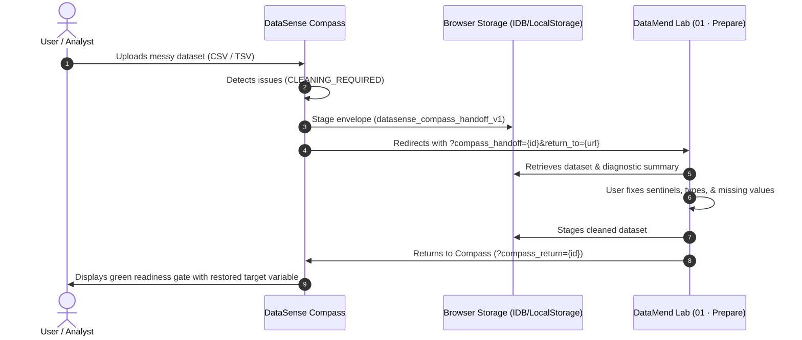

# DataSense Studio & DataSense Compass

[](https://rkohnmn.github.io/datasense-studio/)
[](https://rkohnmn.github.io/datasense-studio/compass/)
[](#)
[-brightgreen?style=flat-square)](#)
[](LICENSE)

**DataSense Studio** is the flagship public website, interactive statistical instrument showcase, and intelligent data-discovery hub connecting five browser-native statistical and data-analysis laboratories under the [`rkohnmn`](https://github.com/rkohnmn) ecosystem.

Built on the principle of **100% client-side privacy**, all data processing, statistical computations, relationship calculations, and visual grammar rendering occur entirely within your local browser sandbox—**zero bytes ever leave your machine**.

---

## Authoritative Ecosystem Architecture

The DataSense ecosystem spans an intelligent discovery engine and five specialized analytical laboratories, each focused on a distinct stage of the exploratory data science lifecycle:

| Stage | Instrument | Primary Function & Specialty | Live Application | GitHub Repository |
| :--- | :--- | :--- | :--- | :--- |
| **`00 · Route`** | **DataSense Compass** | Intelligent dataset profiling, hygiene readiness gating, relationship ranking, and ecosystem routing | [Launch Compass](https://rkohnmn.github.io/datasense-studio/compass/) | [datasense-studio](https://github.com/rkohnmn/datasense-studio) |
| **`01 · Prepare`** | **DataMend Lab** | Diagnostic data hygiene, schema audits, sentinel repair, date formatting, and round-trip cleaning | [Open DataMend Lab](https://rkohnmn.github.io/datamend-lab/) | [rkohnmn/datamend-lab](https://github.com/rkohnmn/datamend-lab) |
| **`02 · Visualize`** | **VisualGrammar** | Interactive Grammar of Graphics exploratory canvas with dynamic encodings and instant faceting | [Open VisualGrammar](https://rkohnmn.github.io/visualgrammar/) | [rkohnmn/visualgrammar](https://github.com/rkohnmn/visualgrammar) |
| **`03 · Investigate`** | **QuartetLab** | Bivariate diagnostics, Anscombe quartet, Simpson's paradox detection, and non-linear relationship audits | [Open QuartetLab](https://rkohnmn.github.io/quartetlab/) | [rkohnmn/quartetlab](https://github.com/rkohnmn/quartetlab) |
| **`04 · Infer`** | **ResampleLab** | Non-parametric bootstrap confidence intervals, hypothesis testing, permutation tests, and sampling error modeling | [Open ResampleLab](https://rkohnmn.github.io/resamplelab/) | [rkohnmn/resamplelab](https://github.com/rkohnmn/resamplelab) |
| **`05 · Forecast`** | **ForecastLab** | Time series decomposition (STL), classical additive/multiplicative models, seasonality modeling, and horizon forecasting | [Open ForecastLab](https://rkohnmn.github.io/forecastlab/) | [rkohnmn/forecastlab](https://github.com/rkohnmn/forecastlab) |

---

## DataSense Compass Capabilities

**DataSense Compass** (`/compass/` and embedded directly on the homepage) solves the fundamental friction in exploratory data analysis: knowing where to begin and whether your data is statistically fit for the intended inquiry.

### The 3 Core Inquiries Answered by Compass

1. **Readiness Gate (`READY`, `READY_WITH_CAUTIONS`, `CLEANING_REQUIRED`)**
   - Automatically inspects tabular data for missing value clusters, unparsed dates, mixed-type columns, sentinel null values (`-999`, `NA`, `null`), zero-variance constants, and excessive cardinality.
   - Categorizes issues into non-destructive warnings vs blocking data-quality failures before routing to downstream laboratories.

2. **Family-Separated Relationship Explorer**
   - Calculates statistically sound relationship matrices separated by variable family:
     - **Numeric vs. Numeric**: Pearson linear correlation $r$ and Spearman rank-order correlation $\rho$ with tie-corrected ranks.
     - **Numeric vs. Categorical**: One-way ANOVA effect sizes ($\eta^2$) and point-biserial correlations.
     - **Categorical vs. Categorical**: Cramer's $V$ contingency coefficients.
   - Detects non-linear curvature (such as inverted-U quadratic trends) that fool standard linear correlation coefficients, proactively recommending QuartetLab.

3. **Ordered Ecosystem Routing**
   - Synthesizes column profiles, data dimensions, and user analytical intents into an ordered multi-stage roadmap across the 5 laboratories.
   - Provides one-click handoff with pre-configured parameters.

### `datasense_compass_handoff_v1` Round-Trip Protocol

DataSense Compass communicates seamlessly with **DataMend Lab** through a standardized, zero-leakage client-side handoff protocol:



---

## Repository Structure

```text
datasense-studio/
├── src/
│   ├── config/
│   │   ├── brand/brand.json              # Studio identity, color tokens & typography
│   │   ├── products/registry.json        # Authoritative 5-app & 10-URL registry
│   │   ├── workflows/workflows.json      # Multi-stage analytical workflows
│   │   └── deployment.json               # Configurable base path (default: /datasense-studio/)
│   ├── lib/recommendations/tasks.json    # Task-based diagnostic routing heuristics
│   ├── styles/main.css                   # Editorial & dark-instrument CSS design system
│   ├── scripts/app.js                    # Interactive workbenches, router & Compass UI
│   └── templates/body.html               # Authoritative semantic HTML template
├── compass/
│   ├── compass_engine.js                 # Standalone client-side statistical & routing engine
│   └── index.html                        # Built /compass/ entry point (generated by build)
├── datamend-adapter/
│   └── datamend-compass-adapter.js       # Drop-in cross-app handoff adapter for DataMend Lab
├── public/
│   ├── robots.txt                        # SEO crawler instructions pointing to sitemap.xml
│   ├── sitemap.xml                       # Google SEO index for hub, compass, and 5 laboratories
│   ├── site.webmanifest                  # PWA / mobile manifest
│   └── screenshots/                      # High-DPI WebP & PNG workspace captures
├── scripts/
│   ├── asset-optimization/build_static.py # Portable static site & single-file builder
│   └── screenshots/capture_workspaces.py  # Workspace asset verification script
├── tests/
│   ├── test_compass_engine.js            # 22-scenario statistical & hygiene test suite
│   ├── unit/test_registry_and_links.py   # Registry, link, asset, SEO & portability tests
│   └── browser/test_rendered_dom.py      # Rendered DOM, search, finder & Compass UI tests
├── dist/                                 # Clean production static build (deployed to Pages)
│   ├── index.html                        # Production hub (~87 KB with external cached assets)
│   ├── compass/index.html                # Dedicated Compass workspace entry point
│   ├── 404.html                          # Custom 404 listing all ecosystem endpoints
│   ├── robots.txt                        # Crawl instructions
│   ├── sitemap.xml                       # SEO sitemap
│   ├── site.webmanifest                  # Web app manifest
│   ├── .nojekyll                         # GitHub Pages asset protection
│   └── assets/                           # External styles.css, compass_engine.js, app.js, screenshots/
├── 404.html                              # Root 404 page for static serving
├── index.html                            # Root index for local serving
├── robots.txt                            # Root robots.txt
├── sitemap.xml                           # Root sitemap.xml
├── site.webmanifest                      # Root web manifest
├── .nojekyll                             # Root GitHub Pages bypass
├── LICENSE                               # MIT License
└── package.json                          # Build and test orchestration scripts
```

---

## Development & Local Execution

### Prerequisites

- **Node.js**: v18+ (verified on Node v25.9.0)
- **Python**: 3.10+ (verified on Python 3.13)
- Modern Evergreen Web Browser (Chrome, Firefox, Safari, Edge)

### Commands

```bash
# 1. Build the modular static production distribution (dist/)
npm run build

# 2. Run the complete automated test suite (Unit, Compass Scenarios & DOM)
npm test

# 3. Preview the production build locally
npm run serve
```

### Deployment Configuration

By default, `src/config/deployment.json` specifies:

```json
{
  "publicBasePath": "/datasense-studio/",
  "canonicalOrigin": "https://rkohnmn.github.io",
  "protectRootPortfolio": true
}
```

This ensures that deploying `datasense-studio` to GitHub Pages under the `datasense-studio` repository targets `https://rkohnmn.github.io/datasense-studio/` and **never interferes with or overwrites** the root portfolio website at `https://rkohnmn.github.io/`.

---

## License

Released under the [MIT License](LICENSE).
Copyright © 2026 [Robert Kohn (rkohnmn)](https://github.com/rkohnmn).
